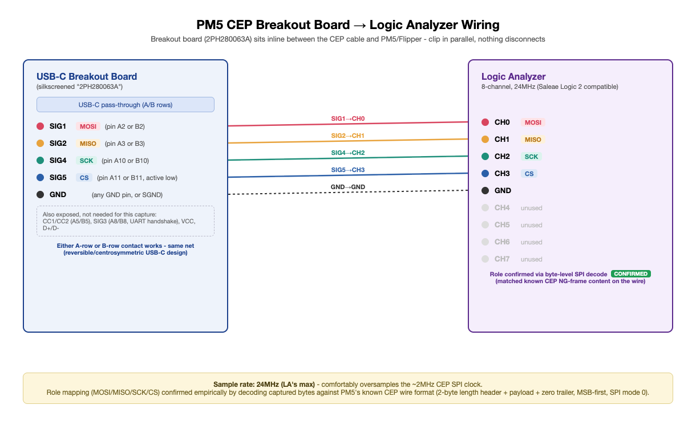

# pm3-cep-logic2

Saleae Logic 2 tools for sniffing and decoding the SPI link between a
[Proxmark5](https://github.com/RfidResearchGroup/proxmark3) and a Flipper
Zero over CEP (the PM5's extended USB-C port).

- **PM3 CEP Frames**: a Logic 2 High Level Analyzer that labels each SPI
  burst with the Proxmark3 command/response name, status, and length.
- **PM5 - CEP - SPI**: a Logic 2 preset with the channels named, the SPI
  analyzer configured, and the data table laid out for the decoder.
- **Capture scripts**: scripted captures, offline decoding, and bus timing.
- **Flipper helpers**: one-shot CLI commands and `expect` scripts for
  driving the Flipper side during a capture.

The decoder works on any SPI link carrying Proxmark3 NG frames, not only
CEP.

## Contents

| Path | What it is |
| --- | --- |
| `extension.json`, `pm3_hla.py`, `pm3_frames.py` | The PM3 CEP Frames Logic 2 extension |
| `logic2-preset/` | The PM5 - CEP - SPI preset |
| `capture-tools/capture.py` | Timed 8-channel/24 MHz capture via the Logic 2 automation API, with SPI and HLA attached, exported to CSV |
| `capture-tools/spi_decode.py` | Offline decode of an exported `digital.csv`; flags malformed CEP frames (sync, length prefix, `PM3a` magic) |
| `capture-tools/find_burst.py` | Groups transitions into SPI transactions and reports the idle gap between them (e.g. the Flipper's poll interval) |
| `flipper-cli/flipper_cli.py` | Sends a single Flipper CLI command over serial, no interactive session needed |
| `flipper-cli/*.exp` | `expect` scripts: relaunch or close the Proxmark5 FAP, open `log debug` |
| `docs/cep-la-wiring.png` | Wiring diagram |

## Wiring

Put a passive USB-C breakout board inline on the CEP cable and clip the
analyzer on in parallel. Nothing needs disconnecting.



| Analyzer | Signal | USB-C pin |
| --- | --- | --- |
| CH0 | MOSI (Flipper -> PM5) | A2 / B2 |
| CH1 | MISO (PM5 -> Flipper) | A3 / B3 |
| CH2 | SCK | A10 / B10 |
| CH3 | CS, active low | A11 / B11 |
| GND | GND | any GND |

Sample at 24 MHz; the CEP clock is about 2 MHz.

Don't use an inline USB-C power meter (e.g. FNIRSI FNB48) in place of
the breakout. Meters have an active PD chip on CC and don't route SBU, so
the CEP link won't come up through them.

## Logic 2 setup

1. **Install the decoder.** Extensions panel -> **Load Existing
   Extension** -> select `extension.json` in this repo.
2. **Import the preset.** Device settings -> **Presets** -> **Import** ->
   `logic2-preset/PM5 - CEP - SPI.logic2Preset`.
3. **Add the decoder.** Add the **PM3 CEP Frames** analyzer with **SPI**
   as its input, then save the preset again so it loads every time. The
   preset can't include the decoder itself, because Logic 2 stores
   extensions by local file path.
4. **Optional.** Right-click the SPI analyzer and untick "Show in data
   table", so the table lists only decoded frames.

Manual SPI settings, if you skip the preset: MSB first, 8 bits per
transfer, CPOL 0, CPHA 0 (mode 0), Enable active low.

### Decoder output

- `CMD <name> len=<n>`: command on MOSI (`PM3a` preamble).
- `RESP <name> st=<status> len=<n>`: response on MISO (`PM3b` preamble).
  `st` is the PM3 return code; 0 is `PM3_SUCCESS`.

Frames are found by searching for the preamble, so the CEP sync bytes
and length prefix in front of a frame are skipped. Unknown command IDs
show in hex; to name more of them, add entries to `CMD_NAMES` in
`pm3_frames.py`. Frame layout follows `include/pm3_cmd.h` in the
proxmark3 repo.

## Scripted captures

```bash
pip install -r capture-tools/requirements.txt
# In Logic 2: Settings -> Enable Automation Server (port 10430)

python3 capture-tools/capture.py my-test 60
python3 capture-tools/spi_decode.py la_captures/<stamp>_my-test/digital.csv [--all]
python3 capture-tools/find_burst.py la_captures/<stamp>_my-test/digital.csv [gap_ms]
```

`capture.py` writes to `./la_captures/` by default; set `LA_CAPTURE_DIR`
to change it. The decoder appears in the GUI only after a capture has
stopped. While recording, only the SPI analyzer shows. This is normal.

## Flipper side

```bash
pip install pyserial
python3 flipper-cli/flipper_cli.py "loader close"
FLIPPER_PORT=/dev/cu.usbmodemflip_Name1 python3 flipper-cli/flipper_cli.py "loader open /ext/apps/rfid/fmps_cxt.fap"
```

Run the `expect` scripts from inside your Flipper firmware checkout (they
call `./fbt cli`):

```bash
cd ~/Momentum-Firmware && expect /path/to/pm3-cep-logic2/flipper-cli/fbt_cli_relaunch_fap.exp
```

Each script checks that the CLI answers a `date` command before it sends
anything else. Run `log debug` last: once it's running, the CLI ignores
any further commands you type.

## Licence

GPL-3.0, same as proxmark3.
